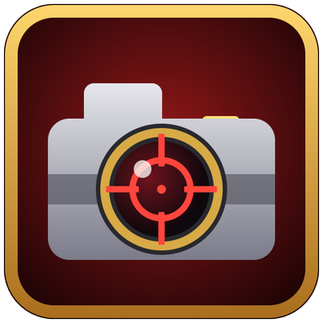

# HonorSnap

> 📸 **A screenshot is taken only when you (or your pet) land the killing blow.** If someone else finishes the enemy off, there's no screenshot. You can change this in the settings: turn off **Only my killing blows**.

**Never lose a world PvP highlight again.** HonorSnap takes a screenshot every time you get an **honorable kill in the open world**: ganks at the Crossroads, Tarren Mill vs Southshore, or someone who tried to stop you in Stranglethorn.

## What it does

- 📸 **Automatic screenshot** on every honorable kill.
- 🟢 **Honorable kills only.** The game only gives honor for enemies that are *not gray* to you (green, yellow, orange or red level), so killing low-level players gives no screenshot.
- ⚔️ **Real kills only.** A screenshot needs actual honorable-kill credit from the game, so duels never count. HonorSnap also stays silent during a duel and for a few seconds after it ends.
- 🌍 **Open world only.** Battlegrounds, arenas, world battlefields during an active battle (Wintergrasp, Tol Barad), dungeons, raids and scenarios are ignored, so your Warsong Gulch games won't fill up the Screenshots folder.
- 🗡️ **"Only my killing blows" option**, on by default: a screenshot is taken only when you or your pet landed the killing blow. Turn it off to count any honorable kill, including group kills.
- 🙈 **Hide the interface** on screenshots (off by default). The interface disappears for a split second while the picture is taken; nameplates and names above heads stay visible.
- 😂 **Emote after a kill**: pick one of 21 emotes (laugh, roar, chicken, spit, salute, train…) and your character performs it at the victim right away, so the enemy sees it before releasing their spirit. Only emotes from the list can be used.
- ⏱️ **Adjustable delay** (0 to 3 seconds) so the corpse hits the ground before the picture is taken.
- 🔊 **Optional camera shutter sound**, off by default. It's replaced by the emote when one is selected.
- 💬 **Chat messages** (each off by default, only you see them, player names in class colors):
  - **My kills**: "You killed Thrall." Also tells you about kills that gave no honor, with the pet's name if your pet landed the blow.
  - **Group kills**: "Jaina killed Thrall." when someone in your group lands the killing blow.
  - **My deaths**: "You were killed by Thrall — Fireball."
- 🔢 **Screenshot counter** with the date and time it started counting.
- ♻️ **Reset buttons** in the options: clear the screenshot counter or restore all settings to defaults (asks for confirmation first, saved screenshots are never deleted).
- ⚙️ **Easy on/off**: a checkbox in the options, a slash command, or a click in the retail Addon Compartment (minimap addon menu).
- 🌐 **English, Ukrainian and Russian interface**. By default the language follows your game client (Russian on Russian clients, English everywhere else) and can be switched in the options. Kill detection doesn't depend on the client language.

## Supported game versions

One download works in every current client:

| Game | Interface |
|---|---|
| Retail (Midnight) | 12.x |
| WoW Forever | 1.60.x |
| Classic Era, Season of Discovery, Hardcore | 1.15.x |
| Burning Crusade Classic (Anniversary) | 2.5.x |
| Titan Reforged (Wrath) | 3.80.x |
| Mists of Pandaria Classic | 5.5.x |

> On Retail and WoW Forever the combat log isn't available to addons, so the "only my killing blows" option uses Blizzard's `PARTY_KILL` event. On Classic clients it uses the combat log.

## Usage

Install it and play. The addon is **enabled by default**.

Settings: **Esc → Options → AddOns → HonorSnap**, or type `/hsnap`.

| Command | Action |
|---|---|
| `/hsnap` | Open settings |
| `/hsnap on` / `off` / `toggle` | Enable, disable or toggle the addon |
| `/hsnap kb` | Toggle "only my killing blows" |
| `/hsnap delay 1.5` | Set the delay before the screenshot (0–3 sec) |
| `/hsnap hideui` | Toggle hiding the interface on screenshots |
| `/hsnap emote laugh` / `off` | Pick the emote after a kill (`/hsnap emote` lists them) |
| `/hsnap sound` | Toggle the shutter sound |
| `/hsnap kills` / `group` / `deaths` | Toggle chat messages about your kills, group kills or your deaths |
| `/hsnap lang auto` / `en` / `ru` / `uk` | Change the addon's language |
| `/hsnap test` | Take a test screenshot (not counted) |
| `/hsnap status` | Print current settings |

`/honorsnap` works as well.

Screenshots are saved by the game to the `Screenshots` folder in your WoW installation (for example `World of Warcraft\_retail_\Screenshots` or `World of Warcraft\_classic_era_\Screenshots`).

## How it works

HonorSnap doesn't guess player levels. It listens for the game's own honorable kill credit (`PLAYER_PVP_KILLS_CHANGED`, with `CHAT_MSG_COMBAT_HONOR_GAIN` and the session honorable-kill counter as a backup), checks that you are in the open world (not in an instance, battleground, arena, active world battlefield or duel), and calls `Screenshot()`. Several signals for the same kill result in just one screenshot.

## FAQ

**I killed a player and there was no screenshot.**
Most often someone else landed the killing blow. With **Only my killing blows** on (the default), a screenshot is taken only when the final hit was yours or your pet's. Turn the option off in the settings (or type `/hsnap kb`) to get a screenshot for any honorable kill, including kills made with your group.

**The killing blow was mine, but still no screenshot.**
The kill gave no honor: the target was gray to you, or (in Classic) you've killed the same player too many times recently. On Retail, world PvP honor also needs War Mode.

**Why nothing in battlegrounds, arenas, dungeons or duels?**
HonorSnap works in the open world only, on purpose, so battlegrounds don't flood your Screenshots folder. Duels never give honor.

**My totem / guardian killed the player, but it didn't count as mine.**
HonorSnap recognizes only your own killing blows and your permanent pet's. Totems and temporary guardians (Searing Totem, Infernal and similar) are separate creatures, so their killing blows don't count as yours. Turn off **Only my killing blows** if you want those kills too.

**The counter says "start date unknown".**
The start date is saved since version 1.1.0. If you had screenshots from 1.0.0, the counter doesn't know when it started. Press **Reset counter** in the settings: the date of your next screenshot becomes the start date.

**I get no "You were killed by…" message on Retail or WoW Forever.**
These clients don't give addons the combat log. HonorSnap reads Blizzard's death recap instead, but the game doesn't always tell addons who the killer was. Then the message is skipped. On Classic clients it always works.

**Where are my screenshots?**
In the `Screenshots` folder of your WoW installation, for example `World of Warcraft\_retail_\Screenshots` or `World of Warcraft\_classic_era_\Screenshots`.

## Feedback

Bugs and suggestions: [GitHub issues](https://github.com/vityachis/HonorSnap/issues).

## License

[Apache License 2.0](LICENSE) © Viktor Chystiakov
